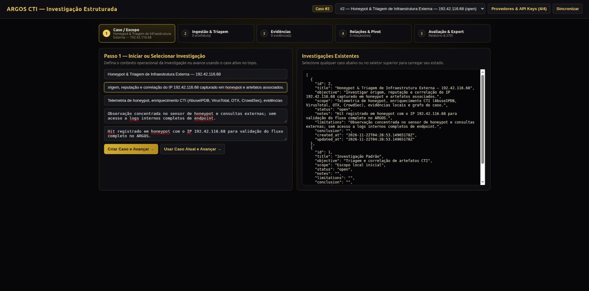
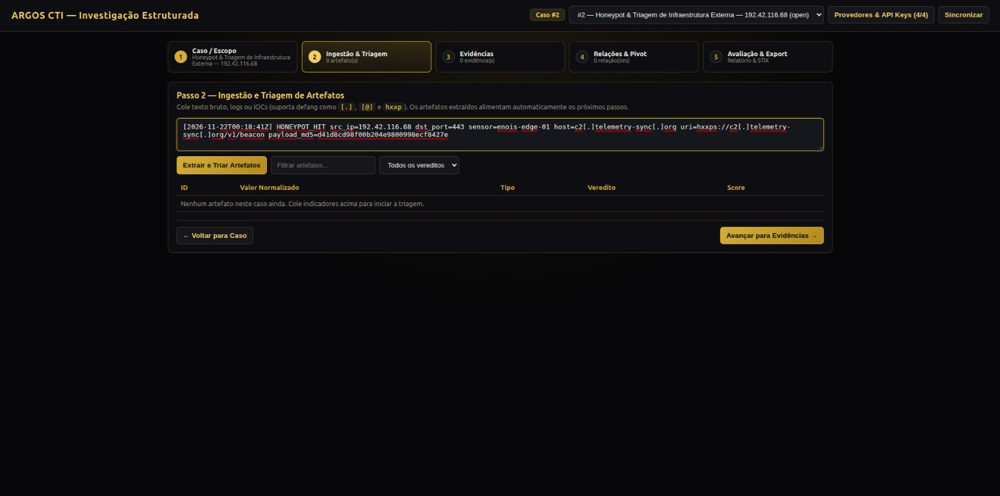
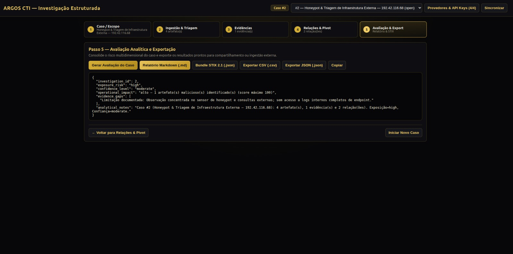

# ARGOS CTI

**ARGOS CTI** is a local-first **Cyber Threat Intelligence (CTI)** and structured threat investigation platform built in **Go**, backed by **SQLite**, and served through an embedded web UI (`127.0.0.1:8080`).

[Leia em Português](README.pt-BR.md)

ARGOS structures incident and Indicator of Compromise (IOC) analysis into a guided **5-step workflow**, combining artifact extraction and normalization, concurrent enrichment across external threat intelligence providers, SHA-256 evidentiary tracking, relationship graph and pivot traversal, case assessment, and multi-format export.

---

## Table of Contents

- [Architecture & Tech Stack](#architecture--tech-stack)
- [Core Capabilities](#core-capabilities)
- [Threat Intelligence Providers & Configuration](#threat-intelligence-providers--configuration)
- [Installation & Execution](#installation--execution)
- [Step-by-Step Workflow Guide](#step-by-step-workflow-guide)
- [Visual Walkthrough](#visual-walkthrough)
- [Repository Hygiene & License](#repository-hygiene--license)

---

## Architecture & Tech Stack

- **Backend & Triage Engine:** **Go** (`cmd/argos`, `internal/engine`, `internal/domain`, `internal/providers`) featuring concurrent provider lookups, local caching, risk scoring, and verdict aggregation.
- **Persistence Layer:** Local **SQLite** database (`argos.db`) storing cases, triaged artifacts, evidence records, graph edges, and provider settings.
- **Embedded Web Interface:** **HTML/CSS/JS** UI served locally at `http://127.0.0.1:8080` via `./argos ui`, organized around a 5-step investigative workflow.
- **Export Formats:** **Markdown (`.md`)** reports, **STIX 2.1 (`.json`)** bundles, **CSV (`.csv`)** exports, and structured **JSON (`.json`)** dumps.

---

## Core Capabilities

1. **Case & Scope Management:** Defines investigation title, analytical objective, scope, visibility limitations/gaps, and initial analyst notes.
2. **Ingestion & Triage:** Extracts and normalizes IPs, domains, URLs, hashes (`MD5`, `SHA-1`, `SHA-256`), and email addresses from free text or structured logs — including defanged indicators (`[.]`, `(.)`, `[:]`, `[@]`, `hxxp://`, `hxxps://`) and `key=value` log tokens (such as `src_ip=...`, `host=...`, `uri=...`, `payload_md5=...`).
3. **Evidentiary Chain:** Records log snippets or observations linked to a case or specific artifact, assigns certainty levels (`observed`, `reported`, `inferred`, `unverified`), and automatically computes a **SHA-256** digest.
4. **Relationship Graph & Pivot:** Connects artifacts with directed relationships (`resolves_to`, `hosted_on`, `part_of`, `contains`, `associated_with`) and traverses connected nodes from a seed indicator up to a configurable depth.
5. **Assessment & Export:** Consolidates case findings and exports human-readable reports or structured intelligence packages.

---

## Threat Intelligence Providers & Configuration

The enrichment engine integrates with:

- **AbuseIPDB**
- **VirusTotal**
- **AlienVault OTX**
- **CrowdSec CTI**

API keys can be configured directly inside the **Providers & API Keys** section of the web UI (persisted in local SQLite) or passed via environment variables before launching the binary.

---

## Installation & Execution

### 1. Clone the repository and run the test suite

~~~bash
git clone https://github.com/Pendragon711/argos-cti.git
cd argos-cti
go test ./...
~~~

### 2. Build the binary and start the web interface

~~~bash
go build -o argos ./cmd/argos
./argos ui
~~~

### 3. Open the web UI

Navigate to:

~~~text
http://127.0.0.1:8080
~~~

---

## Step-by-Step Workflow Guide

### Step 1 — Case & Scope

1. Open `http://127.0.0.1:8080` after running `./argos ui`.
2. Fill out the investigation metadata: **Title**, **Objective**, **Scope**, **Limitations / Visibility Gaps**, and **Notes**.
3. Save/create the case and verify it is selected in the top investigation selector.

### Step 2 — Ingestion & Triage

1. Move to **Ingestion & Triage**.
2. Paste raw logs, alerts, or telemetry lines into the ingestion box. Example:

~~~text
[2026-11-22T00:18:41Z] HONEYPOT_HIT src_ip=192.42.116.68 dst_port=443 sensor=enois-edge-01 host=c2[.]telemetry-sync[.]org uri=hxxps://c2[.]telemetry-sync[.]org/v1/beacon payload_md5=d41d8cd98f00b204e9800998ecf8427e
~~~

3. Click **Extract & Triage Artifacts** to normalize IOCs, query enabled providers, and inspect scores and verdicts in the results table.

### Step 3 — Evidence

1. Move to **Evidence**.
2. Select the **Linked Artifact** (e.g., `192.42.116.68`), set the **Source** (e.g., `honeypot-enois-edge-01`), choose **Certainty** (`observed`), and enter the **Evidence Content**.
3. Click **Record Evidence** and verify the saved record includes an automatically generated `sha256` hash.

### Step 4 — Relationships & Pivot

1. Move to **Relationships & Pivot**.
2. Connect related artifacts using **Source**, **Relationship**, and **Target** (for example, `192.42.116.68` -> `associated_with` -> `c2.telemetry-sync.org` and `c2.telemetry-sync.org` -> `contains` -> `https://c2.telemetry-sync.org/v1/beacon`).
3. Enter a **Seed Artifact** and **Depth** (e.g., `2`) and click **Pivot** to inspect `relations` and `pivot_nodes`.

### Step 5 — Assessment & Export

1. Move to **Assessment & Export**.
2. Click **Generate Case Assessment** to consolidate the case evaluation.
3. Export your findings in the required format:
   - **Markdown Report (`.md`)** for write-ups and documentation.
   - **STIX 2.1 Bundle (`.json`)** for structured intelligence sharing.
   - **CSV (`.csv`)** and **JSON (`.json`)** for tabular analysis or downstream automation.

---

## Visual Walkthrough

### 1. Case & Scope

| Clean Initial Screen | Case Populated |
| :---: | :---: |
|  |  |

### 2. Ingestion & Triage

| Empty Stage | Log Populated | Triage Results |
| :---: | :---: | :---: |
|  |  |  |

### 3. Evidence

| Empty Stage | Evidence Populated | Evidence Recorded |
| :---: | :---: | :---: |
|  |  |  |

### 4. Relationships & Pivot

| Relationships Populated | Pivot Results |
| :---: | :---: |
|  |  |

### 5. Assessment & Export

---

## Repository Hygiene & License

- Keep the compiled binary (`argos`) and local SQLite files (`argos.db`, `argos.db-wal`, `argos.db-shm`) ignored via `.gitignore`, as local databases may store runtime state or API keys configured through the web UI.
- Distributed under the **MIT License** — see [LICENSE](LICENSE).
