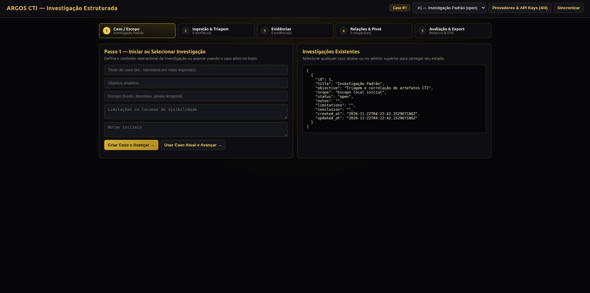
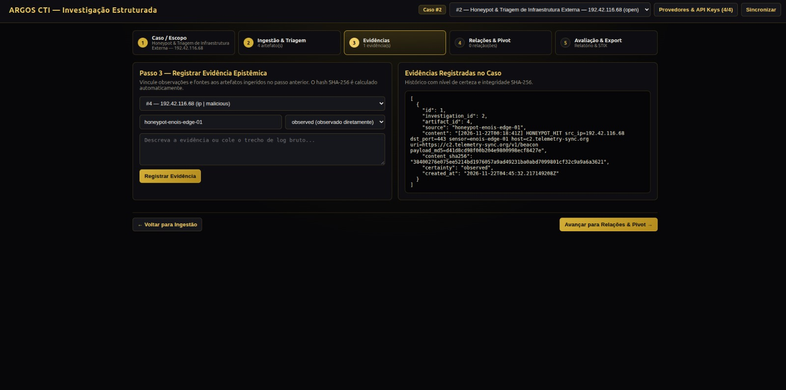

# ARGOS CTI

**ARGOS CTI** é uma plataforma *local-first* de **Cyber Threat Intelligence (CTI)** e investigação estruturada de ameaças, desenvolvida em **Go**, com persistência em **SQLite** e interface web embarcada (`127.0.0.1:8080`) estilizada em tema escuro (`#070709`) com acentos em dourado (`#d4af37`).

O sistema organiza a análise de incidentes e indicadores de comprometimento (IOCs) em um fluxo investigativo guiado de **5 etapas**, combinando extração e normalização de artefatos, enriquecimento concorrente em provedores externos de inteligência, registro de evidências com hash **SHA-256**, análise de relações e travessia por *pivot*, além de consolidação analítica e exportação padronizada.

---

## Sumário

- [Arquitetura e Stack](#arquitetura-e-stack)
- [Principais Funcionalidades](#principais-funcionalidades)
- [Provedores CTI e Configuração](#provedores-cti-e-configuração)
- [Instalação e Execução](#instalação-e-execução)
- [Guia Passo a Passo (Fluxo de 5 Etapas)](#guia-passo-a-passo-fluxo-de-5-etapas)
- [Demonstração Visual](#demonstração-visual)
- [Boas Práticas para Repositório](#boas-práticas-para-repositório)

---

## Arquitetura e Stack

- **Backend & Motor de Triagem:** **Go** (`cmd/argos`, `internal/engine`, `internal/domain`, `internal/providers`) com execução paralela para consulta a provedores, cache local e consolidação de vereditos e *scores* de risco.
- **Persistência:** **SQLite** local (`argos.db`) para armazenamento de investigações, artefatos triados, evidências, relações no grafo e configurações de provedores.
- **Interface Web Embarcada:** Aplicação **HTML/CSS/JS** servida localmente em `http://127.0.0.1:8080` via `./argos ui`, estruturada em torno de um fluxo investigativo de 5 etapas.
- **Formatos de Exportação:** Relatório analítico em **Markdown (`.md`)**, *bundle* **STIX 2.1 (`.json`)**, **CSV (`.csv`)** e *dump* estruturado em **JSON (`.json`)**.

---

## Principais Funcionalidades

1. **Gestão de Casos e Escopo:** Define título, objetivo analítico, escopo da investigação, limitações/lacunas de visibilidade e observações iniciais.
2. **Ingestão e Triagem Automatizada:** Extrai e normaliza IPs, domínios, URLs, hashes (`MD5`, `SHA-1`, `SHA-256`) e e-mails a partir de texto livre ou logs estruturados — incluindo indicadores *defangados* (`[.]`, `(.)`, `[:]`, `[@]`, `hxxp://`, `hxxps://`) e pares `chave=valor` (ex.: `src_ip=...`, `host=...`, `uri=...`, `payload_md5=...`).
3. **Cadeia de Evidências:** Registra trechos de log ou observações vinculadas ao caso ou a um artefato específico, classificando o nível de certeza (`observed`, `reported`, `inferred`, `unverified`) e gerando automaticamente o hash **SHA-256** do conteúdo.
4. **Grafo de Relações e Pivot:** Cria arestas direcionadas entre indicadores (`resolves_to`, `hosted_on`, `part_of`, `contains`, `associated_with`) e executa travessia por *pivot* a partir de um artefato semente com profundidade configurável.
5. **Avaliação Analítica e Exportação:** Consolida o panorama do caso e exporta relatórios legíveis ou intercambiáveis para integração com outras ferramentas e documentação técnica.

---

## Provedores CTI e Configuração

O motor de enriquecimento suporta os seguintes provedores:

- **AbuseIPDB**
- **VirusTotal**
- **AlienVault OTX**
- **CrowdSec CTI**

As chaves de API podem ser configuradas diretamente no painel **Provedores & API Keys** na interface web (ficando persistidas no banco SQLite local) ou injetadas via variáveis de ambiente antes de iniciar o binário.

---

## Instalação e Execução

### 1. Clonar o repositório e rodar os testes unitários/de integração

~~~bash
git clone https://github.com/Pendragon711/argos-cti.git
cd argos-cti
go test ./...
~~~

### 2. Compilar o binário e iniciar a interface web

~~~bash
go build -o argos ./cmd/argos
./argos ui
~~~

### 3. Acessar a aplicação

Abra o navegador em:

~~~text
http://127.0.0.1:8080
~~~

---

## Guia Passo a Passo (Fluxo de 5 Etapas)

### Passo 1 — Caso e Escopo

1. Abra `http://127.0.0.1:8080` após iniciar `./argos ui`.
2. Preencha os dados da investigação: **Título**, **Objetivo**, **Escopo**, **Limitações / Lacunas de Visibilidade** e **Notas**.
3. Salve/crie o caso e confirme que ele está selecionado no seletor superior de investigações.

### Passo 2 — Ingestão e Triagem

1. Avance para **Ingestão & Triagem**.
2. Cole logs brutos, alertas ou trechos de telemetria no campo de ingestão. Exemplo:

~~~text
[2026-11-22T00:18:41Z] HONEYPOT_HIT src_ip=192.42.116.68 dst_port=443 sensor=enois-edge-01 host=c2[.]telemetry-sync[.]org uri=hxxps://c2[.]telemetry-sync[.]org/v1/beacon payload_md5=d41d8cd98f00b204e9800998ecf8427e
~~~

3. Clique em **Extrair e Triar Artefatos** para normalizar os IOCs, consultar os provedores ativos e calcular os *scores* e vereditos na tabela de resultados.

### Passo 3 — Evidências

1. Avance para **Evidências**.
2. Selecione o **Artefato vinculado** (ex.: `192.42.116.68`), informe a **Fonte** (ex.: `honeypot-enois-edge-01`), escolha o nível de **Certeza** (`observed`) e insira o **Conteúdo da evidência**.
3. Clique em **Registrar Evidência** e verifique o registro gerado com o campo `sha256` calculado automaticamente.

### Passo 4 — Relações e Pivot

1. Avance para **Relações & Pivot**.
2. Conecte os artefatos relevantes definindo **Origem**, **Relação** e **Destino** (por exemplo, `192.42.116.68` -> `associated_with` -> `c2.telemetry-sync.org` e `c2.telemetry-sync.org` -> `contains` -> `https://c2.telemetry-sync.org/v1/beacon`).
3. Informe o **Artefato semente (seed)** e a **Profundidade** (ex.: `2`) e clique em **Pivotar** para inspecionar `relations` e `pivot_nodes` no grafo.

### Passo 5 — Avaliação e Exportação

1. Avance para **Avaliação & Exportação**.
2. Clique em **Gerar Avaliação do Caso** para consolidar a análise no painel.
3. Exporte o resultado no formato desejado:
   - **Relatório Markdown (`.md`)** para documentação e *write-ups*.
   - **Bundle STIX 2.1 (`.json`)** para compartilhamento estruturado de inteligência.
   - **CSV (`.csv`)** e **JSON (`.json`)** para análise tabular ou automação.

---

## Demonstração Visual

### 1. Caso e Escopo

| Tela Inicial Limpa | Caso Preenchido |
| :---: | :---: |
|  |  |

### 2. Ingestão e Triagem

| Etapa Vazia | Log Preenchido | Resultado da Triagem |
| :---: | :---: | :---: |
|  |  |  |

### 3. Evidências

| Evidências Vazio | Evidência Preenchida | Evidência Registrada |
| :---: | :---: | :---: |
|  |  |  |

### 4. Relações e Pivot

| Relações Preenchidas | Resultado do Pivot |
| :---: | :---: |
|  |  |

### 5. Avaliação e Exportação

---

## Boas Práticas para Repositório

- Mantenha `argos` (binário compilado) e `argos.db` / `*.db-wal` / `*.db-shm` (banco local com histórico e chaves de API configuradas na UI) listados no `.gitignore`.
- Revise o `git status` e o `git diff` antes de cada `commit` para garantir que nenhum segredo ou artefato temporário seja versionado.
