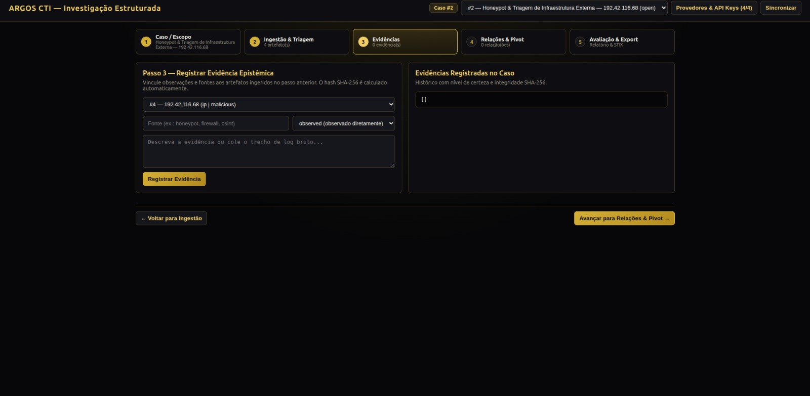
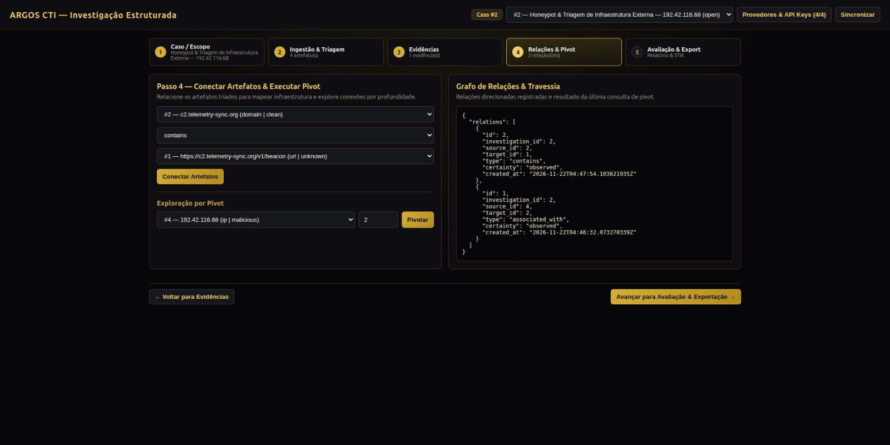
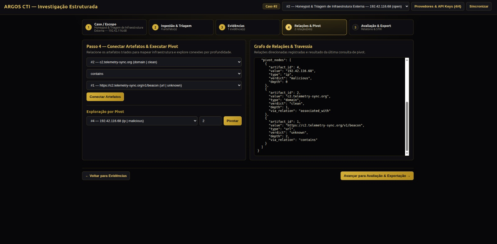

# ARGOS CTI

Plataforma local-first de **Cyber Threat Intelligence (CTI)** e investigação estruturada em 5 etapas, desenvolvida em **Go**, persistência em **SQLite** e interface web embarcada (`127.0.0.1:8080`) com tema escuro (`#070709`) e acentos em dourado (`#d4af37`).

## Principais Recursos

- **Fluxo Investigativo em 5 Etapas:**
  1. **Caso / Escopo:** definição de título, objetivo analítico, escopo, limitações/lacunas de visibilidade e notas iniciais.
  2. **Ingestão & Triagem:** extração e normalização de IOCs (IPs, domínios, URLs, hashes, e-mails), incluindo indicadores defangados (`[.]`, `hxxp`/`hxxps`) e pares chave-valor em logs.
  3. **Evidências:** registro de observações vinculadas a artefatos ou ao caso, com nível de certeza (`observed`, `reported`, `inferred`, `unverified`) e hash **SHA-256** automático.
  4. **Relações & Pivot:** criação de relações direcionadas (`resolves_to`, `hosted_on`, `part_of`, `contains`, `associated_with`) e travessia por profundidade configurável.
  5. **Avaliação & Exportação:** consolidação analítica do caso e exportação em **Markdown (`.md`)**, **STIX 2.1 (`.json`)**, **CSV (`.csv`)** e **JSON (`.json`)**.
- **Provedores CTI Integrados:** suporte a **AbuseIPDB**, **VirusTotal**, **AlienVault OTX** e **CrowdSec CTI**, configuráveis pela UI (persistidos no SQLite) ou via variáveis de ambiente.

## Como Executar

~~~bash
go test ./...
go build -o argos ./cmd/argos
./argos ui
~~~

Acesse `http://127.0.0.1:8080` no navegador.

## Demonstração Visual do Fluxo

### 1. Caso / Escopo
| Tela Inicial Limpa | Caso Preenchido |
| :---: | :---: |
|  |  |

### 2. Ingestão & Triagem
| Etapa Vazia | Log Preenchido | Resultado da Triagem |
| :---: | :---: | :---: |
|  |  |  |

### 3. Evidências
| Evidências Vazio | Evidência Preenchida | Evidência Registrada |
| :---: | :---: | :---: |
|  |  |  |

### 4. Relações & Pivot
| Relações Preenchidas | Resultado do Pivot |
| :---: | :---: |
|  |  |

### 5. Avaliação & Exportação

