# ARGOS — Threat Intelligence Investigation Framework

Local-first, open-source threat intelligence investigation framework in Python (`argos-cti`).

## Principles & Architecture

- **Local-first persistence:** Stores investigations, artifacts, evidence, and relations in SQLite (`~/.local/share/argos/argos.sqlite3` by default, or via `--db-path`).
- **Deterministic normalization:** Sanitizes and classifies indicators (`ipv4`, `ipv6`, `domain`, `url`, `uri`, `hash_md5`, `hash_sha1`, `hash_sha256`, `email`, `asn`, `file`) while preserving original raw values and SHA-256 content hashes.
- **Epistemic accountability:** Tracks `observed`, `reported`, `inferred`, and `unverified` statuses without fabricating arbitrary numeric threat scores.
- **Modular pipeline (`src/argos/workflow.py`):** Coordinates `collectors` (local files and public feeds), `normalizers.ioc`, `core.storage`, `correlation`, `pivot` (bounded traversal), `analysis` (multi-dimensional evaluation), `reporting` (Markdown and JSON), and `exporters` (CSV and STIX 2.1 bundles).

## Project Layout

- `src/argos/analysis/` — Multi-dimensional analytical evaluation & gap identification
- `src/argos/cli/` — Typer + Rich command-line interface
- `src/argos/collectors/` — LocalFileCollector and PublicFeedCollector
- `src/argos/core/` — ArgosConfig and SQLiteStorage persistence layer
- `src/argos/correlation/` — Structural artifact correlation
- `src/argos/exporters/` — CSV and STIX 2.1 bundle exporters
- `src/argos/models/` — Validated Pydantic domain models
- `src/argos/normalizers/` — Deterministic IOC normalization and defang handling
- `src/argos/pivot/` — Bounded, deduplicated relationship traversal
- `src/argos/reporting/` — Markdown and JSON report rendering
- `src/argos/workflow.py` — End-to-end InvestigationWorkflow orchestrator
- `tests/` — Unit and end-to-end integration tests

## CLI Usage

Initialize local storage:

    argos init

Create an investigation and collect indicators from a local file:

    argos investigation create --title "External Infra Triage" --objective "Correlate observed IOCs"
    argos investigation collect --investigation <inv_id> --file indicators.txt

Run bounded relationship pivoting, analytical evaluation, reporting, and exports:

    argos investigation pivot --investigation <inv_id> --seed <artifact_id> --max-depth 2 --max-steps 50
    argos investigation assess --investigation <inv_id>
    argos investigation report --investigation <inv_id> --format markdown --output report.md
    argos investigation export --investigation <inv_id> --format stix --output bundle.stix.json

Inspect artifacts, evidence, and relations:

    argos artifact list --investigation <inv_id>
    argos evidence list --investigation <inv_id>
    argos relation add --investigation <inv_id> --source-ref <src_id> --target-ref <tgt_id> --type associated_with
    argos relation list --investigation <inv_id>

## Development & Verification

Install editable package with dev dependencies and run lint and tests:

    pip install -e ".[dev]"
    ruff check src tests
    pytest

## License

MIT License. See LICENSE for details.

## Demonstração do Fluxo de Investigação (UI Local)

O passo a passo abaixo demonstra um ciclo completo de investigação no **ARGOS CTI Workbench** operando em modo *local-first* sobre SQLite:

### 1. Estado Inicial & Criação da Investigação
Ao iniciar a interface local com um banco SQLite limpo, o analista visualiza o workbench vazio e cria uma nova investigação definindo título, objetivo e escopo.

* **Workbench inicial vazio:**
  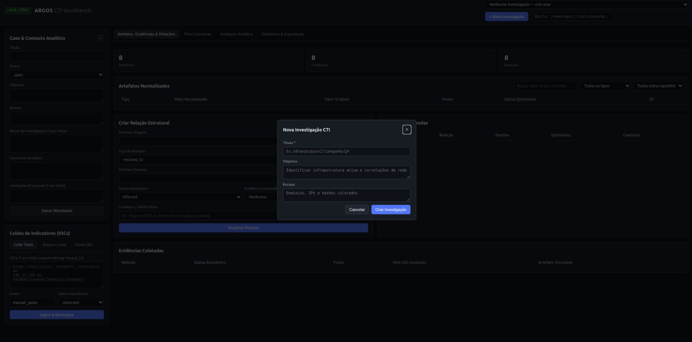
* **Preenchimento dos dados da investigação:**
  
* **Investigação criada no painel:**
  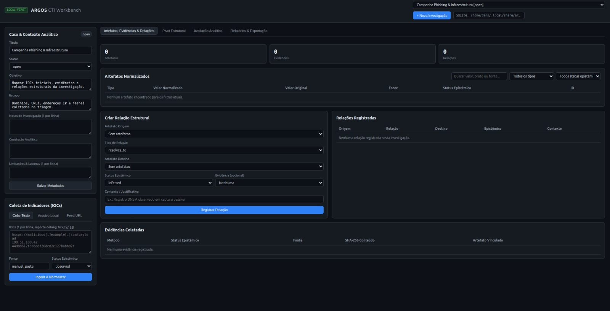

---

### 2. Coleta Manual de IOCs (com Normalização *Defang*)
Na seção **Coleta de Indicadores (IOCs)**, os indicadores são inseridos em texto livre (incluindo formatos com *defang* como `hxxps://c2[.]malicious[.]example/beacon` e `malicious-drop[.]example`), normalizados deterministicamente e vinculados às respectivas evidências.

* **IOCs preenchidos antes da ingestão:**
  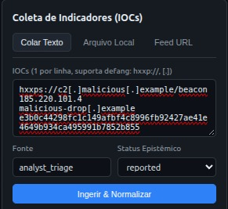
* **Artefatos normalizados e evidências registradas:**
  

---

### 3. Ingestão via Feed Público (URL)
O workbench permite importar listas públicas diretamente via HTTP (como o blocklist de IPs do Feodo Tracker), registrando a origem, o hash de conteúdo e o status epistêmico `reported` para cada artefato.

* **Configuração da URL do feed:**
  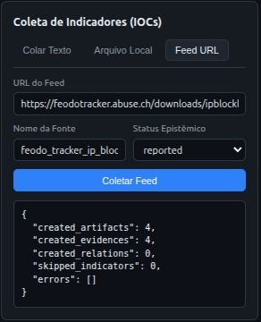
* **Resumo da coleta e novos artefatos adicionados:**
  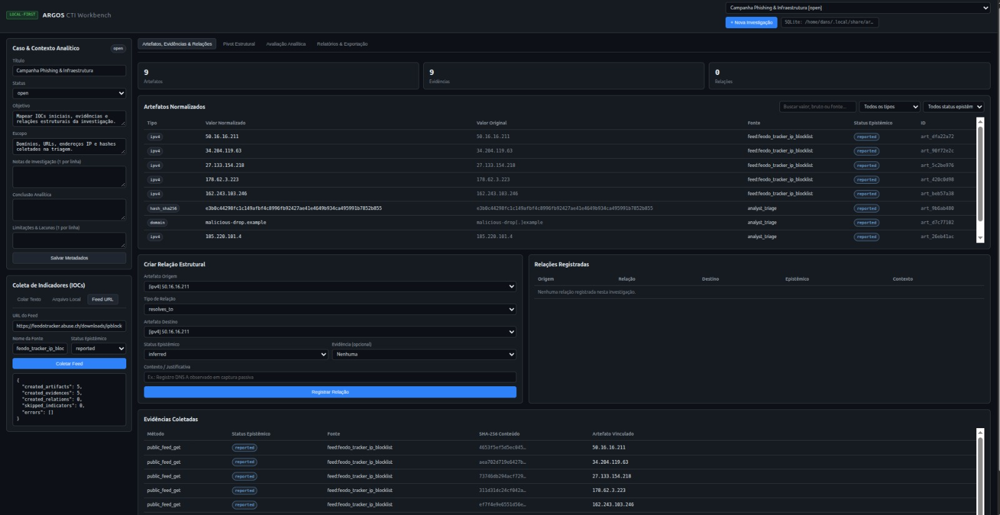

---

### 4. Atualização de Metadados & Contexto Analítico
Com a triagem em andamento, o status do caso é atualizado para `in_progress` junto às notas de investigação, conclusão analítica preliminar e limitações/lacunas.

* **Metadados preenchidos no painel lateral:**
  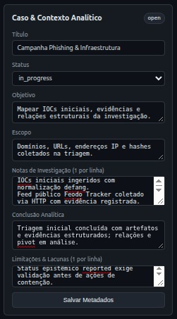
* **Status e metadados salvos na investigação:**
  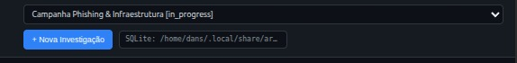

---

### 5. Criação de Relação Estrutural
Na seção **Criar Relação Estrutural**, estabelece-se um vínculo explícito entre artefatos (ex.: `[domain] malicious-drop.example` `resolves_to` `[ipv4] 185.220.101.4`) com status epistêmico (`inferred`) e justificativa analítica.

* **Formulário de relação preenchido:**
  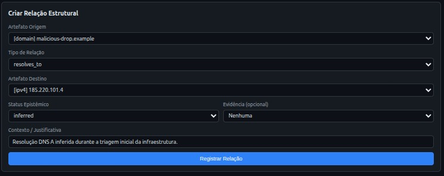
* **Relação registrada na investigação:**
  

---

### 6. Pivot Estrutural Limitado no Grafo
Na aba **Pivot Estrutural**, a exploração parte de um artefato semente respeitando limites explícitos de profundidade (`max_depth`) e passos (`max_steps`), garantindo rastreabilidade sem expansão descontrolada (`stopped_by_limit = false`).

* **Parâmetros do pivot configurados:**
  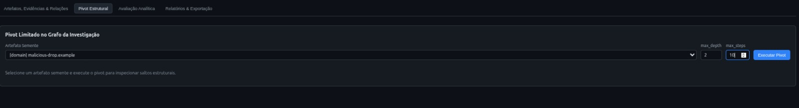
* **Salto percorrendo a relação registrada:**
  

---

### 7. Avaliação Analítica Multidimensional
A aba **Avaliação Analítica** consolida dimensões epistêmicas e operacionais (confiabilidade da fonte, qualidade da evidência, confiança analítica, validade temporal, relevância operacional, risco contextual, lacunas e limitações) sem recorrer a pontuações numéricas arbitrárias.

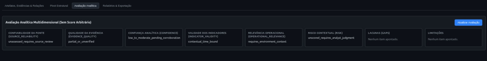

---

### 8. Relatórios & Exportação Padronizada
Por fim, a aba **Relatórios & Exportação** permite pré-visualizar a investigação em **Markdown** ou **JSON** e exportar os resultados em `.md`, `.json`, `.csv` ou **STIX 2.1** (`.json`).

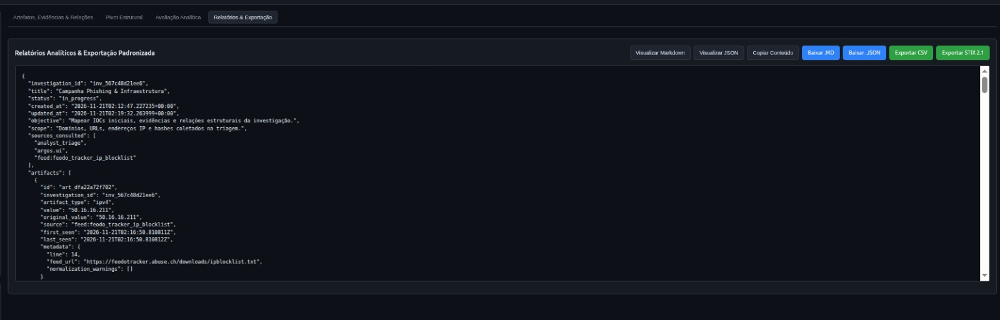
