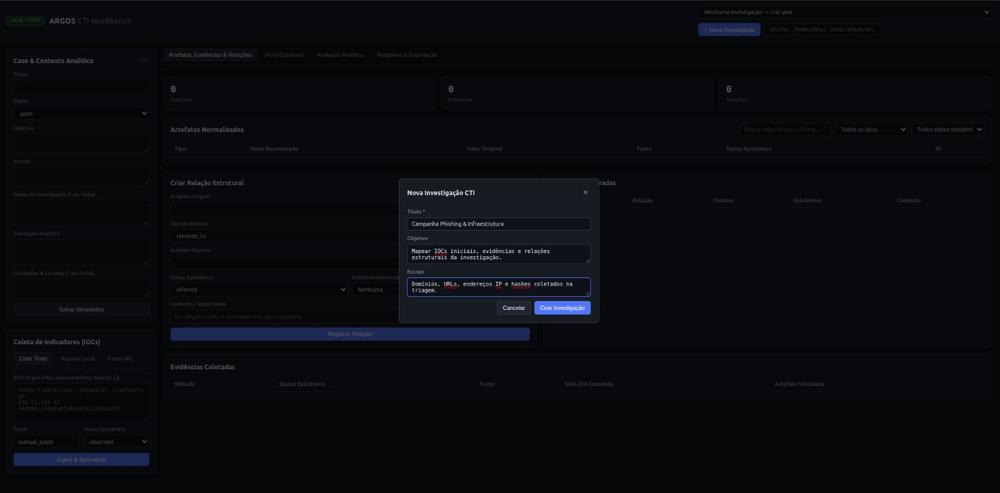
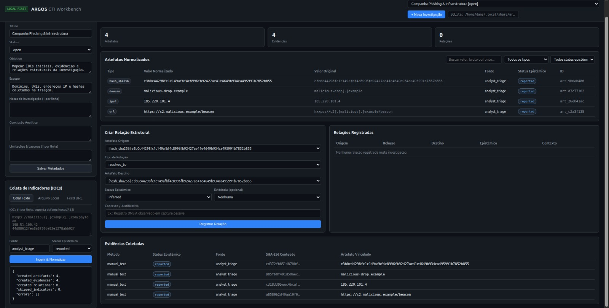
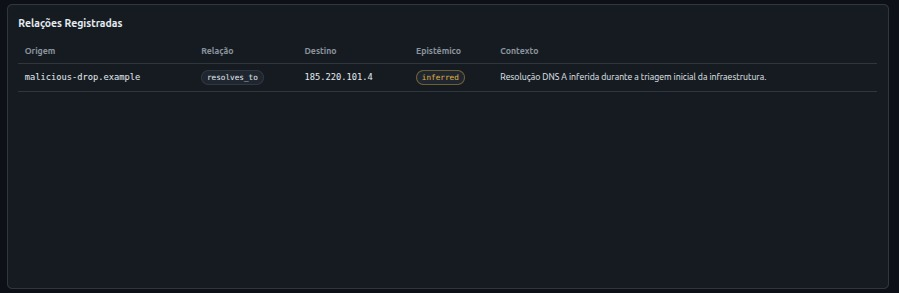
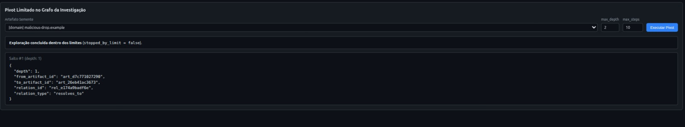

[Leia em Português](README.pt-BR.md)

# ARGOS — Threat Intelligence Investigation Framework

Local-first, open-source threat intelligence investigation framework in Python (`argos-cti`).

## Principles & Architecture

- **Local-first persistence:** Stores investigations, artifacts, evidence, and relations in SQLite (`~/.local/share/argos/argos.sqlite3` by default, or via `--db-path`).
- **Deterministic normalization:** Sanitizes and classifies indicators (`ipv4`, `ipv6`, `domain`, `url`, `uri`, `hash_md5`, `hash_sha1`, `hash_sha256`, `email`, `asn`, `file`) while preserving original raw values and SHA-256 content hashes.
- **Epistemic accountability:** Tracks `observed`, `reported`, `inferred`, and `unverified` statuses without fabricating arbitrary numeric threat scores.
- **Modular pipeline (`src/argos/workflow.py`):** Coordinates `collectors` (local files and public feeds), `normalizers.ioc`, `core.storage`, `correlation`, `pivot` (bounded traversal), `analysis` (multi-dimensional evaluation), `reporting` (Markdown and JSON), and `exporters` (CSV and STIX 2.1 bundles).

## Project Layout

- `src/argos/analysis/` — Multi-dimensional analytical evaluation & gap identification
- `src/argos/cli/` — Typer + Rich command-line interface
- `src/argos/collectors/` — LocalFileCollector and PublicFeedCollector
- `src/argos/core/` — ArgosConfig and SQLiteStorage persistence layer
- `src/argos/correlation/` — Structural artifact correlation
- `src/argos/exporters/` — CSV and STIX 2.1 bundle exporters
- `src/argos/models/` — Validated Pydantic domain models
- `src/argos/normalizers/` — Deterministic IOC normalization and defang handling
- `src/argos/pivot/` — Bounded, deduplicated relationship traversal
- `src/argos/reporting/` — Markdown and JSON report rendering
- `src/argos/ui/` — Local web workbench interface
- `src/argos/workflow.py` — End-to-end InvestigationWorkflow orchestrator
- `tests/` — Unit and end-to-end integration tests

## Installation & Setup

Clone the repository, create and activate a virtual environment, and install the package in editable mode:

    git clone https://github.com/Pendragon711/argos-cti.git
    cd argos-cti
    python3 -m venv .venv
    source .venv/bin/activate
    pip install -e ".[dev]"

> **Note:** Make sure the virtual environment is active (`source .venv/bin/activate`) before running `argos` commands, or invoke `.venv/bin/argos` directly.

## CLI Usage

Initialize local storage:

    argos init

Create an investigation and collect indicators from a local file:

    argos investigation create --title "External Infra Triage" --objective "Correlate observed IOCs"
    argos investigation collect --investigation <inv_id> --file indicators.txt

Run bounded relationship pivoting, analytical evaluation, reporting, and exports:

    argos investigation pivot --investigation <inv_id> --seed <artifact_id> --max-depth 2 --max-steps 50
    argos investigation assess --investigation <inv_id>
    argos investigation report --investigation <inv_id> --format markdown --output report.md
    argos investigation export --investigation <inv_id> --format stix --output bundle.stix.json

Inspect artifacts, evidence, and relations:

    argos artifact list --investigation <inv_id>
    argos evidence list --investigation <inv_id>
    argos relation add --investigation <inv_id> --source-ref <src_id> --target-ref <tgt_id> --type associated_with
    argos relation list --investigation <inv_id>

Launch the local workbench UI:

    argos ui

## Local UI Investigation Walkthrough

The walkthrough below demonstrates an end-to-end investigation workflow in the **ARGOS CTI Workbench** running in *local-first* mode over SQLite:

### 1. Initial State & Investigation Creation
When launching the local UI against a clean SQLite database, the analyst starts from an empty workbench and creates a new investigation with a defined title, objective, and scope.

- **Empty initial workbench:**
  
- **Investigation creation form filled in:**
  
- **Created investigation loaded in the workspace:**
  

---

### 2. Manual IOC Ingestion (with Defang Normalization)
In the **Coleta de Indicadores (IOCs)** panel, raw indicators (including defanged strings such as `hxxps://c2[.]malicious[.]example/beacon` and `malicious-drop[.]example`) are pasted, deterministically normalized, and linked to supporting evidence records.

- **Raw IOCs entered before ingestion:**
  
- **Normalized artifacts and recorded evidence:**
  

---

### 3. Public Feed Ingestion (URL)
The workbench imports public threat feeds directly over HTTP (such as the Feodo Tracker IP blocklist), recording source attribution, content hashes, and the `reported` epistemic status for each ingested artifact.

- **Feed URL configuration:**
  
- **Collection summary and newly ingested artifacts:**
  

---

### 4. Metadata & Analytical Context Updates
As triage progresses, the case status is updated to `in_progress` alongside investigation notes, preliminary analytical conclusions, and explicit limitations/gaps.

- **Metadata fields filled in the sidebar:**
  
- **Updated status and saved investigation metadata:**
  

---

### 5. Structural Relation Creation
In the **Criar Relação Estrutural** card, explicit links are established between artifacts (e.g., `[domain] malicious-drop.example` `resolves_to` `[ipv4] 185.220.101.4`) with an epistemic status (`inferred`) and analytical justification.

- **Structural relation form filled in:**
  
- **Registered relation displayed in the investigation:**
  

---

### 6. Bounded Structural Graph Pivoting
In the **Pivot Estrutural** tab, graph traversal starts from a seed artifact under explicit depth (`max_depth`) and step (`max_steps`) bounds, ensuring deterministic exploration without uncontrolled expansion (`stopped_by_limit = false`).

- **Pivot parameters configured:**
  
- **Traversal hop following the registered relation:**
  

---

### 7. Multi-Dimensional Analytical Assessment
The **Avaliação Analítica** tab evaluates epistemic and operational dimensions—source reliability, evidence quality, analytical confidence, indicator validity, operational relevance, contextual risk, gaps, and limitations—without relying on arbitrary numeric risk scores.

---

### 8. Standardized Reporting & Export
Finally, the **Relatórios & Exportação** tab previews the structured investigation report in **Markdown** or **JSON** and exports outputs in `.md`, `.json`, `.csv`, or **STIX 2.1** (`.json`).

## Development & Verification

Install the editable package with development dependencies and run linting and tests:

    pip install -e ".[dev]"
    ruff check src tests
    pytest

## License

MIT License. See LICENSE for details.
