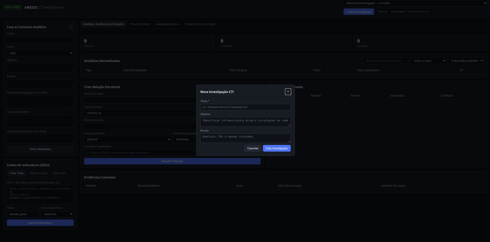
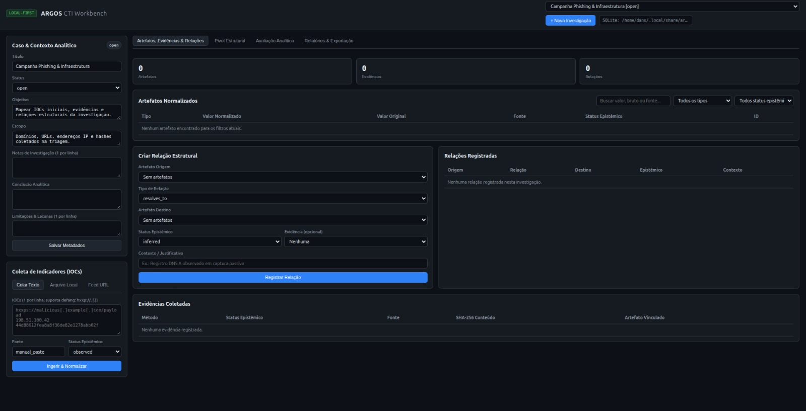
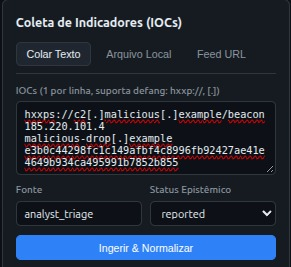
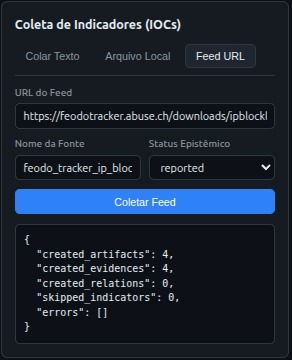
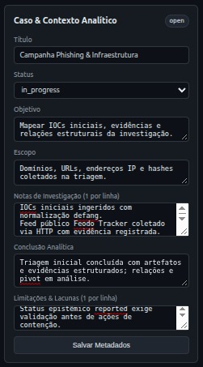
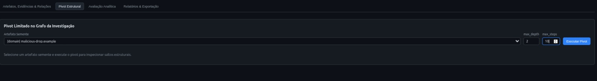
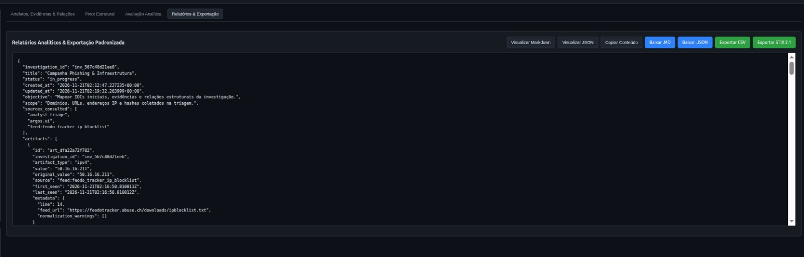

[Read this in English](README.md)

# ARGOS — Framework de Investigação de Inteligência de Ameaças

Framework open-source e *local-first* de investigação de inteligência de ameaças em Python (`argos-cti`).

## Princípios e Arquitetura

- **Persistência local-first:** Armazena investigações, artefatos, evidências e relações em SQLite (`~/.local/share/argos/argos.sqlite3` por padrão, ou via `--db-path`).
- **Normalização determinística:** Higieniza e classifica indicadores (`ipv4`, `ipv6`, `domain`, `url`, `uri`, `hash_md5`, `hash_sha1`, `hash_sha256`, `email`, `asn`, `file`) preservando os valores originais brutos e os hashes SHA-256 de conteúdo.
- **Rastreabilidade epistêmica:** Registra os estados `observed`, `reported`, `inferred` e `unverified` sem inventar pontuações numéricas arbitrárias de ameaça.
- **Pipeline modular (`src/argos/workflow.py`):** Coordena `collectors` (arquivos locais e feeds públicos), `normalizers.ioc`, `core.storage`, `correlation`, `pivot` (travessia limitada), `analysis` (avaliação multidimensional), `reporting` (Markdown e JSON) e `exporters` (bundles CSV e STIX 2.1).

## Estrutura do Projeto

- `src/argos/analysis/` — Avaliação analítica multidimensional e identificação de lacunas
- `src/argos/cli/` — Interface de linha de comando com Typer e Rich
- `src/argos/collectors/` — `LocalFileCollector` e `PublicFeedCollector`
- `src/argos/core/` — Configuração `ArgosConfig` e camada de persistência `SQLiteStorage`
- `src/argos/correlation/` — Correlação estrutural de artefatos
- `src/argos/exporters/` — Exportadores para CSV e bundles STIX 2.1
- `src/argos/models/` — Modelos de domínio validados com Pydantic
- `src/argos/normalizers/` — Normalização determinística de IOCs e tratamento de *defang*
- `src/argos/pivot/` — Travessia limitada e deduplicada de relações
- `src/argos/reporting/` — Renderização de relatórios em Markdown e JSON
- `src/argos/ui/` — Interface web local do workbench
- `src/argos/workflow.py` — Orquestrador ponta a ponta `InvestigationWorkflow`
- `tests/` — Testes unitários e de integração ponta a ponta

## Instalação e Configuração

Clone o repositório, crie e ative um ambiente virtual e instale o pacote em modo editável:

    git clone https://github.com/Pendragon711/argos-cti.git
    cd argos-cti
    python3 -m venv .venv
    source .venv/bin/activate
    pip install -e ".[dev]"

> **Nota:** Certifique-se de que o ambiente virtual esteja ativado (`source .venv/bin/activate`) antes de executar os comandos `argos`, ou chame `.venv/bin/argos` diretamente.

## Uso via CLI

Inicializar o armazenamento local:

    argos init

Criar uma investigação e coletar indicadores de um arquivo local:

    argos investigation create --title "External Infra Triage" --objective "Correlate observed IOCs"
    argos investigation collect --investigation <inv_id> --file indicators.txt

Executar pivot limitado de relações, avaliação analítica, relatórios e exportações:

    argos investigation pivot --investigation <inv_id> --seed <artifact_id> --max-depth 2 --max-steps 50
    argos investigation assess --investigation <inv_id>
    argos investigation report --investigation <inv_id> --format markdown --output report.md
    argos investigation export --investigation <inv_id> --format stix --output bundle.stix.json

Inspecionar artefatos, evidências e relações:

    argos artifact list --investigation <inv_id>
    argos evidence list --investigation <inv_id>
    argos relation add --investigation <inv_id> --source-ref <src_id> --target-ref <tgt_id> --type associated_with
    argos relation list --investigation <inv_id>

Iniciar a interface web local do workbench:

    argos ui

Atalho rápido (`argos.init` em `/usr/local/bin`): `argos.init` (prepara a `.venv` e sobe `argos ui --no-browser`) ou `argos.init <subcomando>`.

## Demonstração do Fluxo de Investigação (UI Local)

O passo a passo abaixo demonstra um ciclo completo de investigação no **ARGOS CTI Workbench** operando em modo *local-first* sobre SQLite:

### 1. Estado Inicial e Criação da Investigação
Ao iniciar a interface local com um banco SQLite limpo, o analista visualiza o workbench vazio e cria uma nova investigação definindo título, objetivo e escopo.

- **Workbench inicial vazio:**
  
- **Preenchimento dos dados da investigação:**
  
- **Investigação criada no painel:**
  

---

### 2. Coleta Manual de IOCs (com Normalização Defang)
Na seção **Coleta de Indicadores (IOCs)**, os indicadores são inseridos em texto livre (incluindo formatos com *defang* como `hxxps://c2[.]malicious[.]example/beacon` e `malicious-drop[.]example`), normalizados deterministicamente e vinculados às respectivas evidências.

- **IOCs preenchidos antes da ingestão:**
  
- **Artefatos normalizados e evidências registradas:**
  

---

### 3. Ingestão via Feed Público (URL)
O workbench importa listas públicas diretamente via HTTP (como o blocklist de IPs do Feodo Tracker), registrando a origem, o hash de conteúdo e o status epistêmico `reported` para cada artefato.

- **Configuração da URL do feed:**
  
- **Resumo da coleta e novos artefatos adicionados:**
  

---

### 4. Atualização de Metadados e Contexto Analítico
Com a triagem em andamento, o status do caso é atualizado para `in_progress` junto às notas de investigação, conclusão analítica preliminar e limitações/lacunas.

- **Metadados preenchidos no painel lateral:**
  
- **Status e metadados salvos na investigação:**
  

---

### 5. Criação de Relação Estrutural
Na seção **Criar Relação Estrutural**, estabelece-se um vínculo explícito entre artefatos (ex.: `[domain] malicious-drop.example` `resolves_to` `[ipv4] 185.220.101.4`) com status epistêmico (`inferred`) e justificativa analítica.

- **Formulário de relação preenchido:**
  
- **Relação registrada na investigação:**
  

---

### 6. Pivot Estrutural Limitado no Grafo
Na aba **Pivot Estrutural**, a exploração parte de um artefato semente respeitando limites explícitos de profundidade (`max_depth`) e passos (`max_steps`), garantindo rastreabilidade sem expansão descontrolada (`stopped_by_limit = false`).

- **Parâmetros do pivot configurados:**
  
- **Salto percorrendo a relação registrada:**
  

---

### 7. Avaliação Analítica Multidimensional
A aba **Avaliação Analítica** consolida dimensões epistêmicas e operacionais (confiabilidade da fonte, qualidade da evidência, confiança analítica, validade temporal, relevância operacional, risco contextual, lacunas e limitações) sem recorrer a pontuações numéricas arbitrárias.

---

### 8. Relatórios e Exportação Padronizada
Por fim, a aba **Relatórios & Exportação** permite pré-visualizar a investigação em **Markdown** ou **JSON** e exportar os resultados em `.md`, `.json`, `.csv` ou **STIX 2.1** (`.json`).

## Desenvolvimento e Verificação

Instale o pacote em modo editável com dependências de desenvolvimento e rode lint e testes:

    pip install -e ".[dev]"
    ruff check src tests
    pytest

## Licença

Licença MIT. Veja o arquivo LICENSE para detalhes.
