# ARGOS CTI

**ARGOS CTI** é uma plataforma *local-first* de **Cyber Threat Intelligence (CTI)** e investigação estruturada de ameaças, desenvolvida em **Go**, com persistência em **SQLite** e interface web embarcada (`127.0.0.1:8080`).

[Read in English](README.md)

---

## Sumário

- [Arquitetura e Stack](#arquitetura-e-stack)
- [Principais Funcionalidades](#principais-funcionalidades)
- [Provedores CTI e Configuração](#provedores-cti-e-configuração)
- [Instalação e Execução](#instalação-e-execução)
- [Guia Passo a Passo (Fluxo de 5 Etapas)](#guia-passo-a-passo-fluxo-de-5-etapas)
- [Demonstração Visual](#demonstração-visual)
- [Boas Práticas e Licença](#boas-práticas-e-licença)

---

## Arquitetura e Stack

- **Backend & Motor de Triagem:** **Go** (`cmd/argos`, `internal/engine`, `internal/domain`, `internal/providers`) com consultas concorrentes a provedores, cache local e consolidação de vereditos e *scores* de risco.
- **Persistência:** Banco **SQLite** local (`argos.db`) para investigações, artefatos triados, evidências, relações no grafo e configurações de provedores.
- **Interface Web Embarcada:** Aplicação **HTML/CSS/JS** servida em `http://127.0.0.1:8080` via `./argos ui` em um fluxo investigativo de 5 etapas.
- **Formatos de Exportação:** **Markdown (`.md`)**, *bundle* **STIX 2.1 (`.json`)**, **CSV (`.csv`)** e **JSON (`.json`)**.

---

## Principais Funcionalidades

1. **Caso e Escopo:** Define título, objetivo analítico, escopo, limitações/lacunas de visibilidade e notas iniciais.
2. **Ingestão e Triagem:** Extrai e normaliza IPs, domínios, URLs, hashes (`MD5`, `SHA-1`, `SHA-256`) e e-mails a partir de texto livre ou logs, incluindo indicadores *defangados* (`[.]`, `(.)`, `[:]`, `[@]`, `hxxp://`, `hxxps://`) e pares `chave=valor` (`src_ip=...`, `host=...`, `uri=...`, `payload_md5=...`).
3. **Evidências:** Registra observações vinculadas ao caso ou a um artefato, com nível de certeza (`observed`, `reported`, `inferred`, `unverified`) e hash **SHA-256** automático.
4. **Relações e Pivot:** Cria relações direcionadas (`resolves_to`, `hosted_on`, `part_of`, `contains`, `associated_with`) e executa travessia por *pivot* a partir de um artefato semente com profundidade configurável.
5. **Avaliação e Exportação:** Consolida a análise do caso e exporta em **Markdown (`.md`)**, **STIX 2.1 (`.json`)**, **CSV (`.csv`)** e **JSON (`.json`)**.

---

## Provedores CTI e Configuração

- **AbuseIPDB**
- **VirusTotal**
- **AlienVault OTX**
- **CrowdSec CTI**

As chaves podem ser salvas diretamente no painel **Provedores & API Keys** na UI (no SQLite local) ou definidas por variáveis de ambiente antes de iniciar o binário.

---

## Instalação e Execução

~~~bash
git clone https://github.com/Pendragon711/argos-cti.git
cd argos-cti
go test ./...
go build -o argos ./cmd/argos
./argos ui
~~~

Acesse `http://127.0.0.1:8080` no navegador.

---

## Guia Passo a Passo (Fluxo de 5 Etapas)

1. **Caso e Escopo:** Preencha **Título**, **Objetivo**, **Escopo**, **Limitações / Lacunas de Visibilidade** e **Notas**, e confirme o caso ativo no seletor superior.
2. **Ingestão e Triagem:** Cole o log ou alerta e clique em **Extrair e Triar Artefatos** para normalizar IOCs, consultar provedores e ver *scores* e vereditos.
3. **Evidências:** Selecione o artefato vinculado, informe **Fonte**, escolha **Certeza** (`observed`), preencha o conteúdo e clique em **Registrar Evidência** para gerar o `sha256`.
4. **Relações e Pivot:** Conecte artefatos (**Origem**, **Relação**, **Destino**) e execute o **Pivot** informando **Artefato semente (seed)** e **Profundidade**.
5. **Avaliação e Exportação:** Clique em **Gerar Avaliação do Caso** e baixe os arquivos em **Markdown (`.md`)**, **STIX 2.1 (`.json`)**, **CSV (`.csv`)** ou **JSON (`.json`)**.

---

## Demonstração Visual

### 1. Caso e Escopo

| Tela Inicial Limpa | Caso Preenchido |
| :---: | :---: |
| 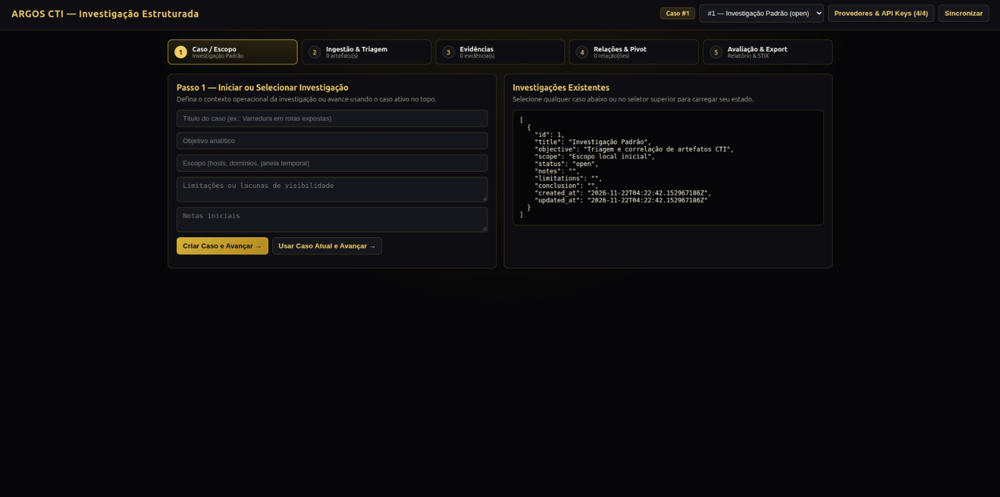 | 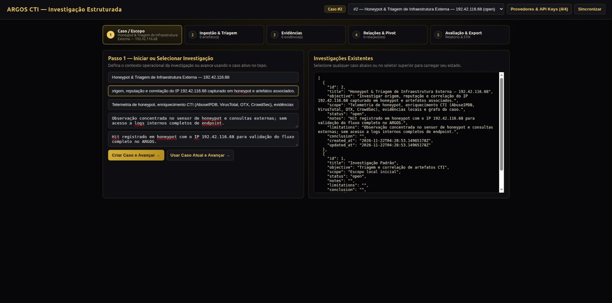 |

### 2. Ingestão e Triagem

| Etapa Vazia | Log Preenchido | Resultado da Triagem |
| :---: | :---: | :---: |
| 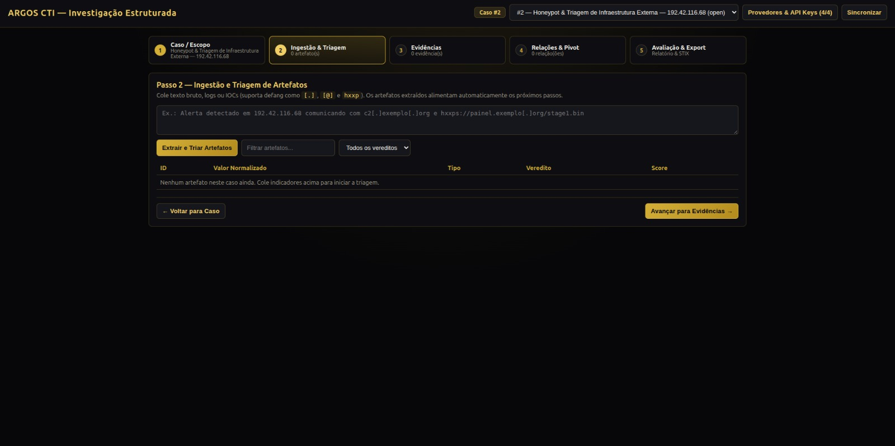 | 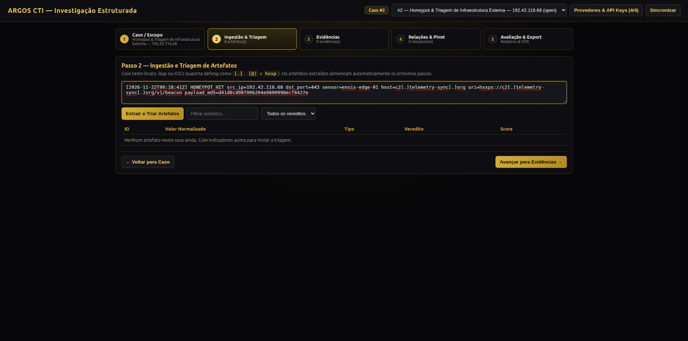 | 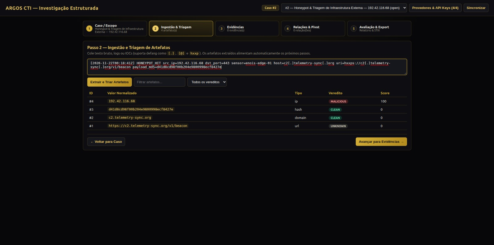 |

### 3. Evidências

| Evidências Vazio | Evidência Preenchida | Evidência Registrada |
| :---: | :---: | :---: |
| 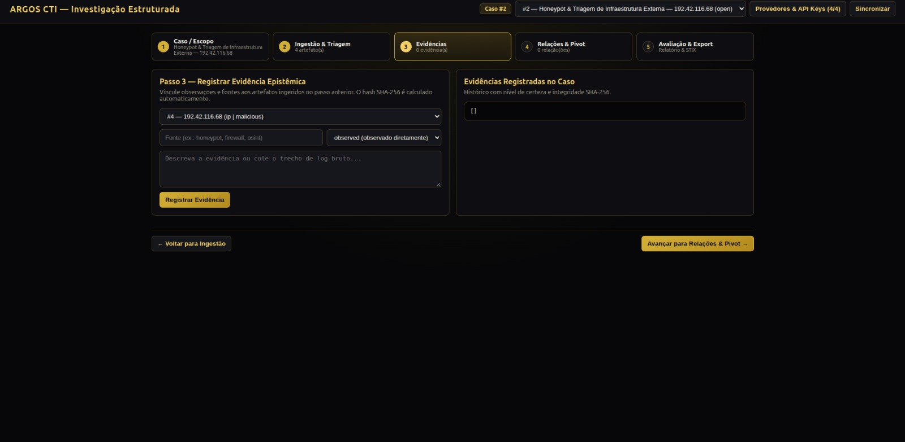 | 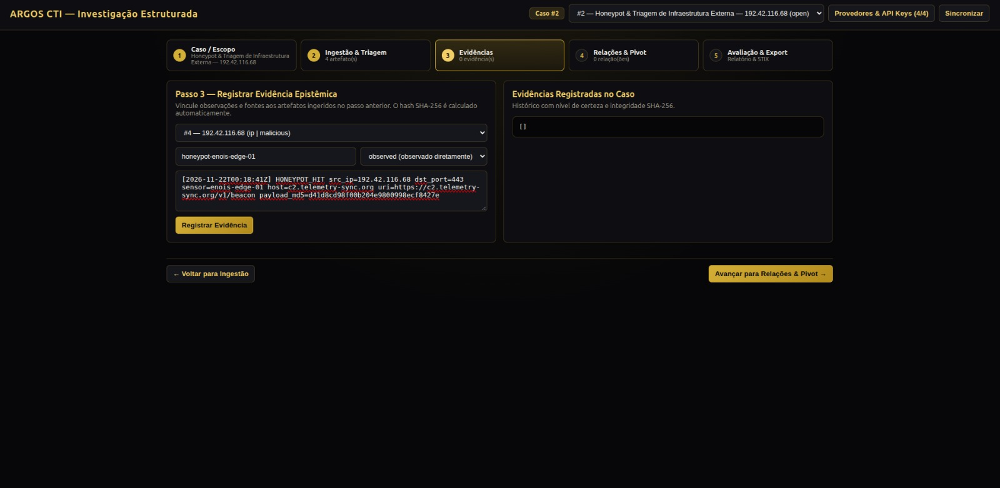 | 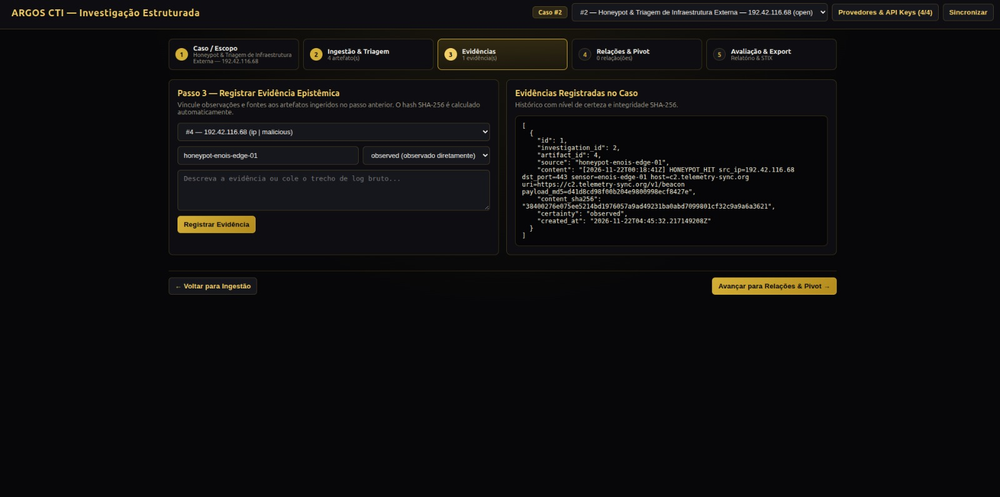 |

### 4. Relações e Pivot

| Relações Preenchidas | Resultado do Pivot |
| :---: | :---: |
| 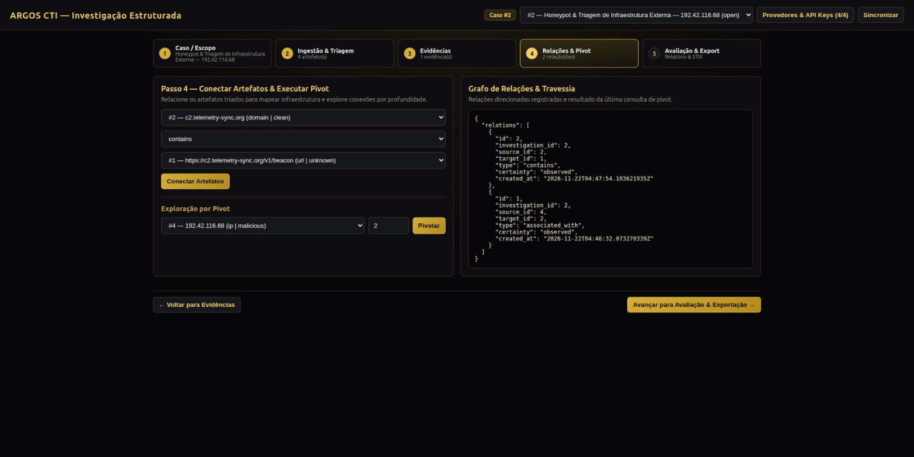 | 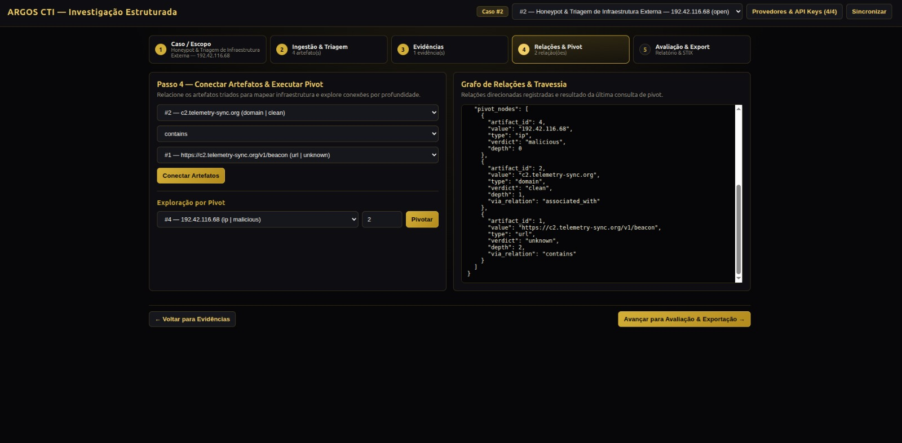 |

### 5. Avaliação e Exportação

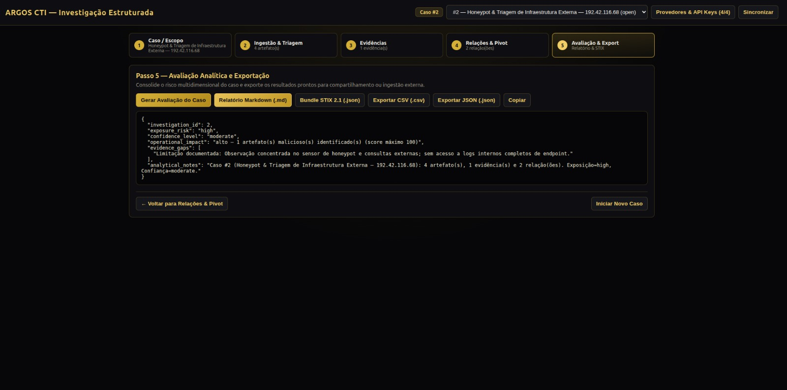

---

## Boas Práticas e Licença

- Não versione o binário `argos` nem os arquivos do SQLite (`argos.db`, `argos.db-wal`, `argos.db-shm`), mantidos no `.gitignore`.
- Licença **MIT** — consulte [LICENSE](LICENSE).
